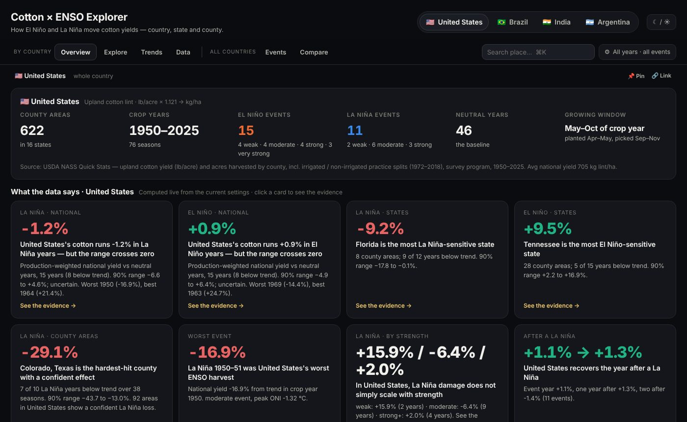
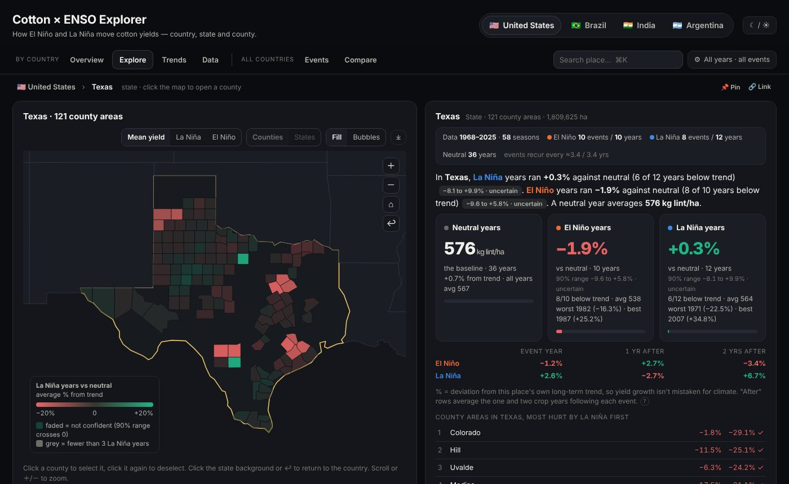
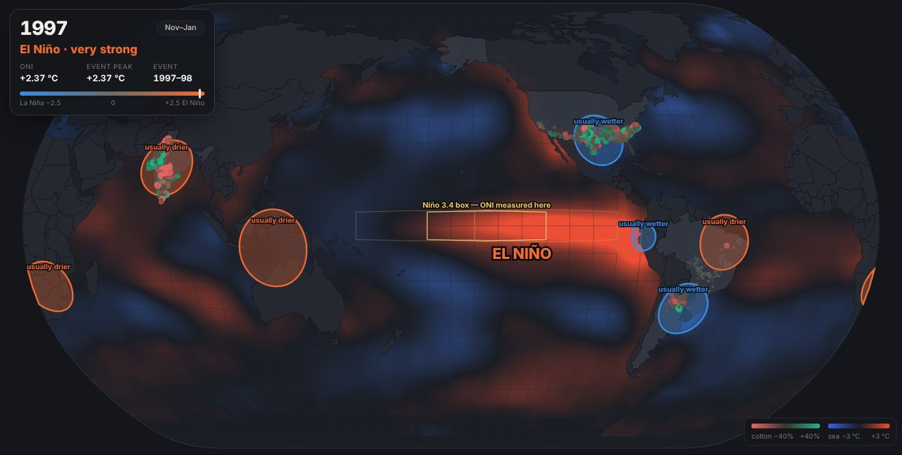
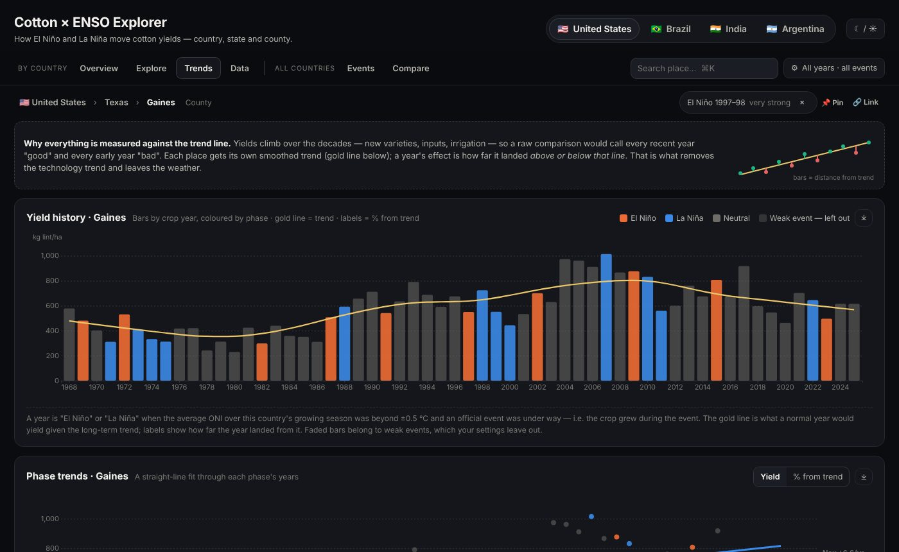

# Cotton × ENSO Explorer

**How El Niño and La Niña move cotton yields — country, state and county, across four of the world's largest producers.**

An interactive, single-file dashboard that links 75 years of the El Niño–Southern Oscillation (ENSO) to subnational cotton yields in the **United States, Brazil, India and Argentina**. Every effect is measured against each place's own long-term yield trend, so gains from new varieties and technology aren't mistaken for climate.

**▶ Live dashboard: https://leoanish.github.io/cotton-enso-explorer/**

| Overview | Explore |
|---|---|
|  |  |
| **ENSO on the globe** | **Trends** |
|  |  |

---

## What it shows

| Tab | Scope | What you get |
|---|---|---|
| **Overview** | one country | Country card and headline findings computed live from your settings |
| **Explore** | one country | Map that drills down *country → state → county / municipality / district*; mean yield or El Niño / La Niña effect, with uncertain areas faded |
| **Trends** | one place | Yield history against its trend, per-phase trend lines, effect by event strength, before → during → after, and any single event |
| **Data** | one place | Year-by-year table, CSV export, full method |
| **Events** | all countries | ONI record 1950 → today, event list, an animated globe of **observed sea-surface temperature** (NOAA ERSST v5) with cotton areas recoloured each year, and a 52-second **video / GIF** of every winter 1950–2025 with every cotton area lit up (`media/`) |
| **Compare** | all countries | Four-quadrant (NW / NE / SW / SE) and **continent** (North America, South America, Asia, Australia) analysis, pinned places, most sensitive areas, countries side by side |
| **Sources** | all countries | Every dataset with its publisher, coverage, units, and links to the official source, the exact file or query used, and our copy in this repo |

Settings (years, which event strengths count, per-year vs per-event weighting, exploratory countries on/off, US irrigated / non-irrigated) apply everywhere. Links encode the current view, so you can share an exact state of the dashboard.

### Weather and the 2026 outlook

Every area also gets its growing-season **temperature, rainfall, SPI, SPEI and scPDSI** (NOAA GHCN-CAMS and PREC/L, 0.5°, through Oct 2026; CRU TS 4.10 scPDSI through 2025), to show *why* a season went badly. A ridge regression on ENSO + heat + drought/wetness, whose strength is chosen by leave-one-year-out hindcasts, gives a **2026 yield outlook** for every county, district, state and country (Australia: 2027), with a 90% range and an honest skill score. Where ENSO and weather never beat the trend in past years, the outlook is the trend. See *Weather & outlook* in the dashboard and §4.14–4.15 of the guide.

## Coverage

| Country | Unit | Areas mapped | Crop years | Growing window used for ENSO phase |
|---|---|---|---|---|
| United States | County | 622 (+135 irrigated, 233 non-irrigated) | 1950–2025 | May–Oct |
| Brazil | Municipality | 147 | 1974–2025 | Dec (prev. yr)–May |
| India | District | 146 | 1966–2024 (2020–24 from UPAg, calibrated) | Jun–Nov |
| Argentina | Department | 72 | 1970–2025 | Nov (prev. yr)–Apr |
| China β | Province | 15 | 1961–2025 (2018 missing) | May–Oct |
| Pakistan β | District unit (1981 boundaries) | 27 | 1981–2008, 2010–2018, 2021–2023 | May–Oct |
| Australia β | State (NSW, Queensland) | 2 | 1990–2026 (harvest year) | Nov (prev. yr)–Apr |
| ENSO | — | 43 events (23 El Niño incl. the ongoing 2026 event, 20 La Niña) | 1950–ASO 2026 | — |

**β = exploratory layer** (coarser units, gaps or interpolated area weights; switch off under ⚙ Settings).

All yields are shown as **kg lint per hectare**. Brazil and Argentina report seed cotton, converted with a fixed ginning turnout (0.40 and 0.33); their levels are approximate, while their % deviations are unaffected.

## Method in brief

1. **Events** — NOAA's Oceanic Niño Index (3-month mean sea-surface temperature anomaly in the Niño 3.4 box, 5°N–5°S, 170°W–120°W). An event is ≥ 5 consecutive overlapping seasons at or beyond ±0.5 °C; strength is the peak category held for ≥ 3 seasons (weak < 1.0, moderate 1.0–1.4, strong 1.5–1.9, very strong ≥ 2.0 °C).
2. **Which crop year an event hits** — each crop year takes the mean ONI over that country's growing window, so one event can land on different harvests north and south of the equator.
3. **Detrending** — each place gets a robust LOWESS trend through its own yields; a year's deviation is yield ÷ trend − 1.
4. **Effect** — mean deviation in El Niño (or La Niña) years minus the mean in neutral years. Optionally one observation per event rather than per year.
5. **Confidence** — 90% Welch t-interval for the difference between phase and neutral years. *Confident* means the range excludes zero. Calibrated by shuffling each place's years: ≈10% of places are flagged when there is no real effect, as a 90% range should give.
6. **Aggregates** — state and national series are production ÷ harvested area across all reporting areas.

The full method, inclusion rules and caveats are in the dashboard's **Data → Method** section, and — explained step by step for non-specialists, with worked examples — in **[docs/knowledge_base.md](docs/knowledge_base.md)**.

## Ask the data — AI assistant

The ✦ **Ask the data** button opens a chat with an open-weight model (OpenAI's `gpt-oss-120b`, served by [Groq](https://groq.com)). It does not answer from memory: it calls tools that run *in the page* on the dashboard's own data — place statistics, single years, events, rankings, quadrants, what-if settings — and searches [the guide](docs/knowledge_base.md) for methods and definitions. It can also open the matching view for you. Every tool call and its raw result can be expanded under the answer.

The Groq key never reaches the browser: requests go through a small Cloudflare Worker in [`chat-proxy/`](chat-proxy/) that keeps the key as a secret and only answers this site. Set-up takes three commands — see [chat-proxy/README.md](chat-proxy/README.md). Until it is deployed, visitors can paste their own Groq key in the chat's ⚙ (stored only in their browser).

> **Status:** exploratory. Before drawing formal conclusions, see *Limitations* below.

## Data sources

| Source | Data | Where it lives here |
|---|---|---|
| NOAA Climate Prediction Center | Oceanic Niño Index (ERSSTv5) | `data/raw/noaa/oni.csv` (via the [`ahuang11/oni`](https://github.com/ahuang11/oni) mirror) |
| NOAA PSL | ERSST v5 monthly sea-surface temperature | not committed (160 MB) — `scripts/fetch_ersst.sh`; processed fields in `data/processed/sst_fields.json` |
| USDA NASS Quick Stats | Upland cotton yield & acres harvested by county; irrigated / non-irrigated splits | `data/raw/usda_nass/` |
| IBGE — Produção Agrícola Municipal | Algodão herbáceo, área colhida & produção by município (tables 1612, 5457) | `data/raw/ibge/` |
| ICRISAT District Level Database | Cotton area & production by district (Rajasthan 2012–15, 2017 corrected for a bales/tonnes slip) | `data/raw/icrisat/` |
| Ministry of Agriculture (India) — UPAg / DES district APY | Cotton area & production by district, 1997–2024 (extension 2020–24, calibrated on 2013–19) | `data/raw/india_des/` |
| National Bureau of Statistics of China | Yearly cotton bulletins 2019–2025, Statistical Yearbooks; 1961–2017 provincial yields (Mendeley `bms88fv7zz`) | `data/raw/china/` |
| Pakistan Bureau of Statistics; Punjab & Sindh Bureaus of Statistics; MNFSR | District cotton area & production (bales) | `data/raw/pakistan/` |
| ABARES — Australian Crop Report No. 219, state data | Cotton lint harvested area & production by state | `data/raw/australia/` |
| Ministerio de Economía (Argentina) — Estimaciones Agrícolas | Algodón by departamento | `data/raw/magyp/` |
| Boundaries | US counties & states ([us-atlas](https://github.com/topojson/us-atlas)), world ([world-atlas](https://github.com/topojson/world-atlas) / Natural Earth), Brazil municipalities & states (IBGE, via [`rschapo/pam-dashboard`](https://github.com/rschapo/pam-dashboard)), India districts ([`udit-001/india-maps-data`](https://github.com/udit-001/india-maps-data)), China & Pakistan provinces (Natural Earth admin-1), Pakistan districts ([geoBoundaries](https://www.geoboundaries.org/)), Argentina departments ([`mgaitan/departamentos_argentina`](https://github.com/mgaitan/departamentos_argentina)) | `data/raw/boundaries/`, `data/geo/` |

> **Note on the ENSO index.** NOAA's Climate Prediction Center now also publishes an ERSST v6-based ONI and, since NWS Public Information Statement 26-05, uses the Relative Oceanic Niño Index (RONI) for official ENSO monitoring. This project uses the ERSST v5 ONI, which CPC continues to update monthly ([ONI v5 table](https://cpc.ncep.noaa.gov/products/analysis_monitoring/enso/oni/v5/), [RONI table](https://cpc.ncep.noaa.gov/products/analysis_monitoring/enso/roni/v5/)).

The IBGE 2000–2025 tables were taken from a SIDRA export in [`elisiara/agrodata`](https://github.com/elisiara/agrodata); the 1974–1999 table was pulled directly from the SIDRA API. ICRISAT files come from the GitHub mirrors [`2026ak05087/ML`](https://github.com/2026ak05087/ML) (1966–2017) and [`KalaRenganathan/causal-ml-crop-yield`](https://github.com/KalaRenganathan/causal-ml-crop-yield) (1990–2019). Each source remains under its own terms; please cite the original providers.

## Repository layout

```
index.html                 the dashboard (self-contained; this is what GitHub Pages serves)
src/                       template.html + app.js (dashboard) + chat.js (AI assistant)
docs/knowledge_base.md     the complete plain-language guide (also what the assistant searches)
chat-proxy/                Cloudflare Worker holding the Groq key; PROXY_URL = its address
scripts/
  paths.py                 all paths, relative to the repo
  build_geo.py             simplified boundaries and centroids → data/geo/
  build_core.py            ONI events, phase assignment, detrending, US/BR/IN loaders
  build_data.py            full build: + Argentina, US irrigation splits, Brazil 1974–99, polygons
  build_sst.py             ERSST v5 → seasonal anomaly fields
  build_page.py            assembles index.html
  new_countries.py         China / Pakistan / (Australia) loaders, stable Pakistan district units, their maps
  parse_china.py           NBS bulletins + yearbooks + 1961–2017 compilation → china_province_cotton_merged.csv
  parse_pakistan_*.py      PBS 1981–2008, Punjab 2011–2018, Sindh 2010–2018, MNFSR 2021–2023 → district CSVs
  parse_australia.py       ABARES state crop data → au_state_cotton.csv
  extend_india.py          UPAg 2020–2024 matched + calibrated to ICRISAT districts (writes a match report)
  build_video.py           the ENSO × cotton animation → media/*.mp4, *.gif
  check_calibration.py     checks that the 90% ranges flag ≈10% of places when years are shuffled
  fetch_ersst.sh           downloads ERSST v5 (only needed for build_sst.py)
data/
  raw/                     original downloads, gzipped, one folder per provider
  geo/                     derived boundary files used by the dashboard
  processed/               dashboard_data.json, sst_fields.json
docs/img/                  screenshots
media/                     enso_cotton_1950_2025.mp4 / .gif
```

## Rebuilding

Requires Python ≥ 3.10 and Node ≥ 18.

```bash
pip install -r requirements.txt
npm install
make all          # geo → data → page   (writes index.html)
make sst          # optional: refresh sea-surface fields (downloads ~160 MB first)
make climate      # optional: refresh weather + 2026 outlook (downloads ~830 MB first; ~2 min)
python scripts/build_video.py   # optional: re-render media/enso_cotton_1950_2025.mp4 and .gif (~8 min)
```

A full rebuild takes about 15 seconds and reproduces the published `index.html` byte for byte (apart from the build date).

## Hosting on GitHub Pages

1. Push this repository to GitHub.
2. **Settings → Pages → Build and deployment → Source: Deploy from a branch → `main` / `(root)`**.
3. The dashboard appears at `https://<username>.github.io/<repo-name>/` within a minute or two.

`index.html` is a single 4.8 MB file with everything inlined, so it also works offline — open it straight from disk.

## Limitations

- Means comparisons, not a panel regression; areas within a country share the same ENSO years, so their effects are not independent.
- A smoothed trend can partly absorb runs of bad years, which makes multi-year effects look slightly smaller (conservative).
- US yields are per *harvested* acre: dryland abandonment in drought years flatters dryland averages.
- Brazil's production shifted from the rainfed north-east to irrigated Mato Grosso in the 1990s; India adopted Bt cotton after 2002. Neither structural break is modelled.
- China, Pakistan and Australia are exploratory (Australia: two states, ~90% irrigated, so yield understates ENSO's effect): China is province-level with interpolated area weights before 2019; Pakistan has gaps (2009, 2019–2020) and merges post-1981 district splits. Both are dominated by irrigated cotton.
- India 2020–2024 covers 100 of 146 districts (91% of area); the others stop in 2019.
- Teleconnection zones on the globe are schematic (typical NOAA/IRI patterns), not observed rainfall.

## Contributors

- **Anish Bhattarai** (University of Georgia) — research question, design, data decisions, interpretation.
- **Claude** (Anthropic) — AI collaborator: data collection and parsing, the build pipeline, the dashboard and AI assistant code, statistical audit, the guide and the ENSO animation, all under the author's direction. Commits Claude contributed to carry a `Co-Authored-By: Claude` trailer.

## Citation

If you use this dashboard or dataset, please cite it (see `CITATION.cff`) and the original data providers.

## Licence

Code: MIT (see `LICENSE`). Data: each source under its own terms, as listed above.

Inspired by the [ENSO-Yield Explorer](https://lucasvitantonio.com/projects/enso-yield-explorer/) (corn & soybean, US) and the AgroENSO project.
