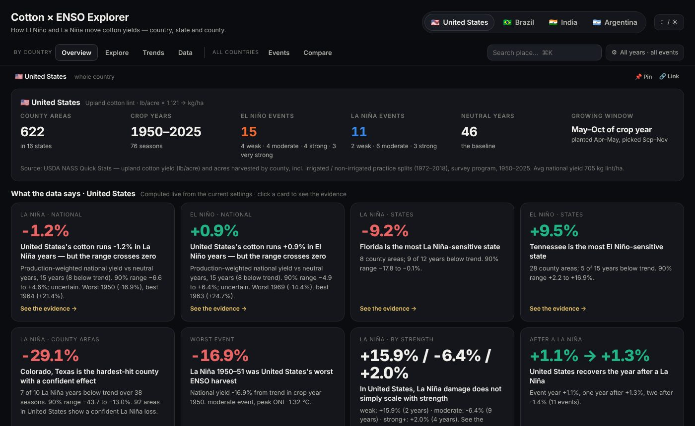
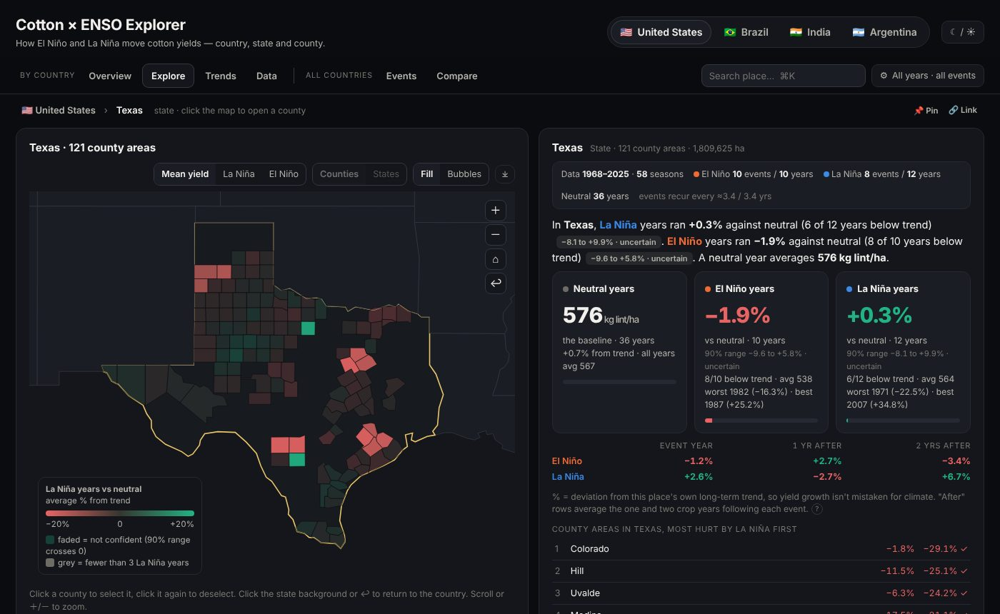
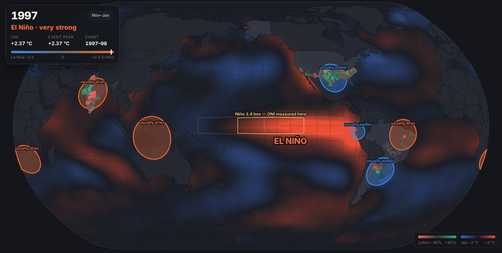
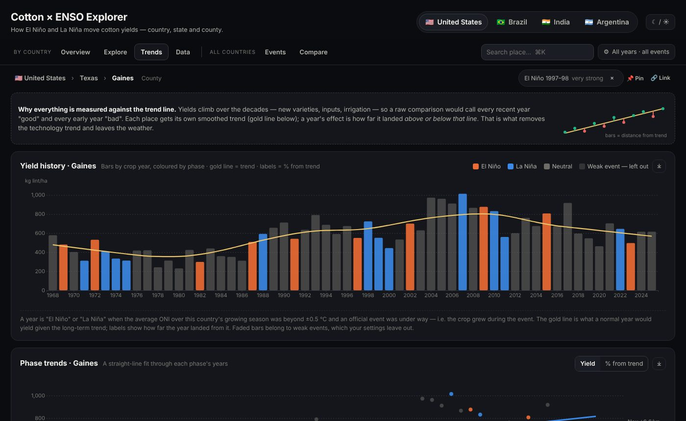

# Cotton × ENSO Explorer

**How El Niño and La Niña move cotton yields — country, state and county, across four of the world's largest producers.**

An interactive, single-file dashboard that links 75 years of the El Niño–Southern Oscillation (ENSO) to subnational cotton yields in the **United States, Brazil, India and Argentina**. Every effect is measured against each place's own long-term yield trend, so gains from new varieties and technology aren't mistaken for climate.

**▶ Live dashboard: https://leoanish.github.io/cotton-enso-explorer/**

| Overview | Explore |
|---|---|
|  |  |
| **ENSO on the globe** | **Trends** |
|  |  |

---

## What it shows

| Tab | Scope | What you get |
|---|---|---|
| **Overview** | one country | Country card and headline findings computed live from your settings |
| **Explore** | one country | Map that drills down *country → state → county / municipality / district*; mean yield or El Niño / La Niña effect, with uncertain areas faded |
| **Trends** | one place | Yield history against its trend, per-phase trend lines, effect by event strength, before → during → after, and any single event |
| **Data** | one place | Year-by-year table, CSV export, full method |
| **Events** | all countries | ONI record 1950 → today, event list, and an animated globe of **observed sea-surface temperature** (NOAA ERSST v5) with cotton areas recoloured each year |
| **Compare** | all countries | Four-quadrant (NW / NE / SW / SE) analysis, pinned places, most sensitive areas, countries side by side |

Settings (years, which event strengths count, per-year vs per-event weighting, US irrigated / non-irrigated) apply everywhere. Links encode the current view, so you can share an exact state of the dashboard.

## Coverage

| Country | Unit | Areas mapped | Crop years | Growing window used for ENSO phase |
|---|---|---|---|---|
| United States | County | 622 (+135 irrigated, 233 non-irrigated) | 1950–2025 | May–Oct |
| Brazil | Municipality | 147 | 1974–2025 | Dec (prev. yr)–May |
| India | District | 144 | 1966–2019 | Jun–Nov |
| Argentina | Department | 72 | 1970–2025 | Nov (prev. yr)–Apr |
| ENSO | — | 42 events (22 El Niño, 20 La Niña) | 1950–2026 | — |

All yields are shown as **kg lint per hectare**. Brazil and Argentina report seed cotton, converted with a fixed ginning turnout (0.40 and 0.33); their levels are approximate, while their % deviations are unaffected.

## Method in brief

1. **Events** — NOAA's Oceanic Niño Index (3-month mean sea-surface temperature anomaly in the Niño 3.4 box, 5°N–5°S, 170°W–120°W). An event is ≥ 5 consecutive overlapping seasons at or beyond ±0.5 °C; strength is the peak category held for ≥ 3 seasons (weak < 1.0, moderate 1.0–1.4, strong 1.5–1.9, very strong ≥ 2.0 °C).
2. **Which crop year an event hits** — each crop year takes the mean ONI over that country's growing window, so one event can land on different harvests north and south of the equator.
3. **Detrending** — each place gets a robust LOWESS trend through its own yields; a year's deviation is yield ÷ trend − 1.
4. **Effect** — mean deviation in El Niño (or La Niña) years minus the mean in neutral years. Optionally one observation per event rather than per year.
5. **Confidence** — 90% bootstrap range (400 resamples). *Confident* means the range excludes zero.
6. **Aggregates** — state and national series are production ÷ harvested area across all reporting areas.

The full method, inclusion rules and caveats are in the dashboard's **Data → Method** section.

> **Status:** exploratory. Before drawing formal conclusions, see *Limitations* below.

## Data sources

| Source | Data | Where it lives here |
|---|---|---|
| NOAA Climate Prediction Center | Oceanic Niño Index (ERSSTv5) | `data/raw/noaa/oni.csv` (via the [`ahuang11/oni`](https://github.com/ahuang11/oni) mirror) |
| NOAA PSL | ERSST v5 monthly sea-surface temperature | not committed (160 MB) — `scripts/fetch_ersst.sh`; processed fields in `data/processed/sst_fields.json` |
| USDA NASS Quick Stats | Upland cotton yield & acres harvested by county; irrigated / non-irrigated splits | `data/raw/usda_nass/` |
| IBGE — Produção Agrícola Municipal | Algodão herbáceo, área colhida & produção by município (tables 1612, 5457) | `data/raw/ibge/` |
| ICRISAT District Level Database | Cotton area & production by district | `data/raw/icrisat/` |
| Ministerio de Economía (Argentina) — Estimaciones Agrícolas | Algodón by departamento | `data/raw/magyp/` |
| Boundaries | US counties & states ([us-atlas](https://github.com/topojson/us-atlas)), world ([world-atlas](https://github.com/topojson/world-atlas) / Natural Earth), Brazil municipalities & states (IBGE, via [`rschapo/pam-dashboard`](https://github.com/rschapo/pam-dashboard)), India districts ([`udit-001/india-maps-data`](https://github.com/udit-001/india-maps-data)), Argentina departments ([`mgaitan/departamentos_argentina`](https://github.com/mgaitan/departamentos_argentina)) | `data/raw/boundaries/`, `data/geo/` |

The IBGE 2000–2025 tables were taken from a SIDRA export in [`elisiara/agrodata`](https://github.com/elisiara/agrodata); the 1974–1999 table was pulled directly from the SIDRA API. ICRISAT files come from the GitHub mirrors [`2026ak05087/ML`](https://github.com/2026ak05087/ML) (1966–2017) and [`KalaRenganathan/causal-ml-crop-yield`](https://github.com/KalaRenganathan/causal-ml-crop-yield) (1990–2019). Each source remains under its own terms; please cite the original providers.

## Repository layout

```
index.html                 the dashboard (self-contained; this is what GitHub Pages serves)
src/                       template.html + app.js — the dashboard source
scripts/
  paths.py                 all paths, relative to the repo
  build_geo.py             simplified boundaries and centroids → data/geo/
  build_core.py            ONI events, phase assignment, detrending, US/BR/IN loaders
  build_data.py            full build: + Argentina, US irrigation splits, Brazil 1974–99, polygons
  build_sst.py             ERSST v5 → seasonal anomaly fields
  build_page.py            assembles index.html
  fetch_ersst.sh           downloads ERSST v5 (only needed for build_sst.py)
data/
  raw/                     original downloads, gzipped, one folder per provider
  geo/                     derived boundary files used by the dashboard
  processed/               dashboard_data.json, sst_fields.json
docs/img/                  screenshots
```

## Rebuilding

Requires Python ≥ 3.10 and Node ≥ 18.

```bash
pip install -r requirements.txt
npm install
make all          # geo → data → page   (writes index.html)
make sst          # optional: refresh sea-surface fields (downloads ~160 MB first)
```

A full rebuild takes about 15 seconds and reproduces the published `index.html` byte for byte (apart from the build date).

## Hosting on GitHub Pages

1. Push this repository to GitHub.
2. **Settings → Pages → Build and deployment → Source: Deploy from a branch → `main` / `(root)`**.
3. The dashboard appears at `https://<username>.github.io/<repo-name>/` within a minute or two.

`index.html` is a single 4.4 MB file with everything inlined, so it also works offline — open it straight from disk.

## Limitations

- Means comparisons, not a panel regression; areas within a country share the same ENSO years, so their effects are not independent.
- A smoothed trend can partly absorb runs of bad years, which makes multi-year effects look slightly smaller (conservative).
- US yields are per *harvested* acre: dryland abandonment in drought years flatters dryland averages.
- Brazil's production shifted from the rainfed north-east to irrigated Mato Grosso in the 1990s; India adopted Bt cotton after 2002. Neither structural break is modelled.
- Teleconnection zones on the globe are schematic (typical NOAA/IRI patterns), not observed rainfall.

## Citation

If you use this dashboard or dataset, please cite it (see `CITATION.cff`) and the original data providers.

## Licence

Code: MIT (see `LICENSE`). Data: each source under its own terms, as listed above.

Inspired by the [ENSO-Yield Explorer](https://lucasvitantonio.com/projects/enso-yield-explorer/) (corn & soybean, US) and the AgroENSO project.
